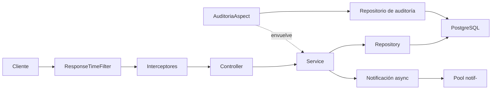
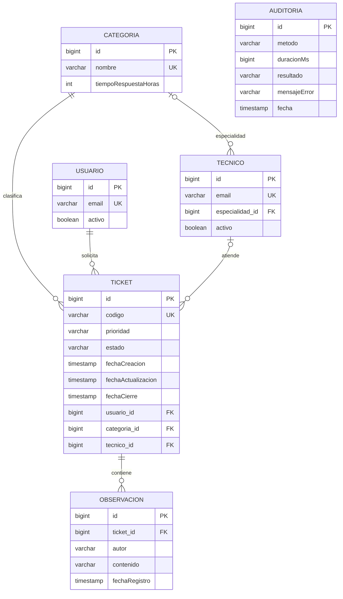

# API empresarial de atención de tickets de soporte – Grupo 8

[](https://github.com/Romario1615/API-empresarial-con-Spring-Boot-y-arquitectura-N-capas/actions/workflows/ci.yml)

**Universidad de las Fuerzas Armadas ESPE**  
Asignatura: Programación Avanzada · NRC 36759  
Docente: Ing. Eleana Inés Jerez Villota  
Taller Grupal 1.1 · Grupo 8

Integrantes:

- Romario Javier Alban Moreta
- Millie Stefanny Alvarez Villon
- Richard Jesús Pante Quiguiri
- Bárbara Camila Rodas Paredes

## Problema y alcance

La mesa de ayuda necesita registrar solicitudes, distinguir su urgencia, asignar especialistas y mantener el historial de atención. Esta API centraliza categorías, usuarios, técnicos, tickets y observaciones; controla el ciclo de vida y la carga de trabajo de los técnicos. Incluye trazabilidad HTTP, auditoría de servicios y una demostración de notificaciones bloqueantes y asíncronas.

Las respuestas usan DTOs y nunca serializan entidades JPA. La lógica de negocio está en servicios; los controladores únicamente validan solicitudes y delegan.

## Tecnologías

| Componente | Tecnología |
| --- | --- |
| Lenguaje | Java 21 |
| Construcción | Maven y Maven Wrapper |
| Aplicación | Spring Boot 4.1.2 |
| HTTP | Spring Web MVC, Spring Framework 7, Jakarta Servlet |
| Persistencia | Spring Data JPA, Hibernate 7 |
| Base de datos real | PostgreSQL 17 |
| Validación | Jakarta Bean Validation |
| JSON | Jackson 3: `tools.jackson.*`; anotaciones `com.fasterxml.jackson.annotation` |
| Aspectos | `spring-boot-starter-aspectj` |
| Concurrencia | `@Async`, `CompletableFuture`, `ThreadPoolTaskExecutor` |
| Pruebas | JUnit Jupiter, Mockito, MockMvc, AssertJ, H2 en modo PostgreSQL |
| Automatización | GitHub Actions |

H2 tiene alcance exclusivo `test`. Se mantienen los starters de pruebas de JPA, Validation y Web MVC. No se utiliza Lombok, consola H2 ni el antiguo `spring-boot-starter-aop`.

## Arquitectura N capas



Los servicios usan inyección por constructor y transacciones de escritura; las lecturas tienen `@Transactional(readOnly = true)`. El mapeo a DTO ocurre dentro de la transacción porque `open-in-view=false`. Las asociaciones `ManyToOne` son `LAZY`.

```text
src/main/java/ec/edu/espe/soportetickets/
├── SoporteTicketsApplication.java
├── controller/           # Endpoints REST
├── service/              # Contratos de los servicios
│   └── impl/             # Reglas y transacciones
├── repository/           # Spring Data, consultas derivadas y JPQL
├── entity/               # Modelo JPA con getters/setters explícitos
│   └── enums/            # Prioridad, EstadoTicket
├── dto/
│   ├── request/          # Records con Bean Validation en español
│   └── response/         # Records de salida y ErrorResponse
├── mapper/               # Conversión manual de entidades a DTOs
├── exception/            # Excepciones y GlobalExceptionHandler
├── config/               # WebConfig, AsyncConfig y DataLoader
├── interceptor/          # Logging, API key y filtro de tiempo
├── aspect/               # AuditoriaAspect
└── notification/         # Simulación SMTP bloqueante y async
src/main/resources/application.properties
src/test/java/ec/edu/espe/soportetickets/
├── controller/
├── service/impl/
├── interceptor/
├── aspect/
├── repository/
└── support/
src/test/resources/application-test.properties
requests/soporte-tickets.http
.github/workflows/ci.yml
```

## Modelo de datos

| Entidad / tabla | Campos principales | Relaciones y restricciones |
| --- | --- | --- |
| Categoria / categorias | id, nombre(80), descripcion(255), tiempoRespuestaHoras | Nombre único; horas > 0; tiene tickets y especialistas |
| Usuario / usuarios | id, nombres(100), email(254), departamento(80), activo | Email único; solicitante de muchos tickets |
| Tecnico / tecnicos | id, nombres(100), email(254), especialidad_id, activo | Email único; especialidad opcional; muchos tickets asignados |
| Ticket / tickets | id, codigo(40), titulo(120), descripcion(2000), prioridad, estado, fechas | Código único; usuario y categoría obligatorios; técnico opcional |
| Observacion / observaciones | id, ticket_id, autor(100), contenido(1000), fechaRegistro | Ticket obligatorio; cascada y eliminación de huérfanos |
| RegistroAuditoria / auditoria | id, metodo(150), duracionMs, resultado(5), mensajeError(500), fecha | Resultado OK o ERROR; independiente del ticket |



Las restricciones tienen nombres explícitos: `uk_categorias_nombre`, `uk_usuarios_email`, `uk_tecnicos_email`, `uk_tickets_codigo`, `fk_tickets_usuario`, `fk_tickets_categoria`, `fk_tickets_tecnico`, `fk_tecnicos_especialidad` y `fk_observaciones_ticket`.

El ID se genera con `IDENTITY`. Al insertar un ticket se usa temporalmente `TMP-<UUID>` para cumplir `NOT NULL` y unicidad; después se sustituye por `String.format("TCK-%06d", id)`. El número depende del ID real y puede tener saltos. `@PrePersist` y `@PreUpdate` completan las fechas.

## Reglas de negocio

1. Todo ticket creado por la API nace `ABIERTO` y requiere un usuario activo.
2. Las únicas transiciones son las indicadas en la tabla siguiente.
3. Entrar a `EN_PROCESO` requiere técnico asignado y activo.
4. Solo se asignan técnicos activos. Cada técnico admite como máximo cinco tickets `ABIERTO` o `EN_PROCESO`. La reapertura comprueba también la capacidad; reasignar el mismo ticket al mismo técnico no incrementa la carga.
5. Los tickets `CERRADO` y `CANCELADO` no admiten nuevas observaciones.
6. Los correos de usuarios y técnicos, y los nombres de categorías, se verifican sin distinguir mayúsculas. Los correos se almacenan en minúsculas.
7. No se elimina un técnico con tickets activos ni una categoría con tickets. Solo se eliminan tickets `ABIERTO` o `CANCELADO`.
8. Al pasar a `CERRADO` se registra `fechaCierre`.

| Estado actual | Destinos permitidos |
| --- | --- |
| ABIERTO | EN_PROCESO, CANCELADO |
| EN_PROCESO | RESUELTO, CANCELADO |
| RESUELTO | CERRADO, EN_PROCESO |
| CERRADO | Ninguno |
| CANCELADO | Ninguno |

El comentario opcional del cambio de estado se agrega como observación de autor `Sistema` antes de aplicar el nuevo estado, incluido un cierre o cancelación. Si se elimina un técnico sin tickets activos, se conservan sus tickets históricos y se deja la asignación en null. Al eliminar una categoría sin tickets se liberan las especialidades de los técnicos.

Las escrituras de tickets usan bloqueo pesimista. La comprobación de carga y la asignación bloquean también la fila del técnico para serializar asignaciones concurrentes al mismo técnico.

## Endpoints

Base: `http://localhost:8080/api`. Toda escritura exige `X-API-KEY: grupo8-soporte-2026`. Las lecturas y `OPTIONS` no exigen clave. Los POST de creación devuelven 201 y `Location`; los DELETE exitosos, 204 sin cuerpo; las consultas, actualizaciones y demostraciones, 200.

| Método | Ruta | Función |
| --- | --- | --- |
| GET | /categorias | Listar categorías |
| POST | /categorias | Crear categoría |
| PUT | /categorias/{id} | Actualizar categoría |
| DELETE | /categorias/{id} | Eliminar categoría |
| GET | /usuarios | Listar usuarios |
| GET | /usuarios/{id} | Obtener usuario |
| POST | /usuarios | Crear usuario |
| PUT | /usuarios/{id} | Actualizar usuario |
| GET | /tecnicos | Listar técnicos |
| GET | /tecnicos/{id} | Obtener técnico |
| POST | /tecnicos | Crear técnico |
| PUT | /tecnicos/{id} | Actualizar técnico |
| DELETE | /tecnicos/{id} | Eliminar técnico |
| GET | /tecnicos/{id}/tickets-pendientes | Activos del técnico por urgencia y antigüedad |
| GET | /tickets?estado=&prioridad= | Listar con filtros opcionales combinables |
| GET | /tickets/{id} | Detalle con observaciones |
| GET | /tickets/pendientes | Pendientes por prioridad y fecha |
| GET | /tickets/estadisticas | Conteo agrupado por estado |
| POST | /tickets | Crear ticket |
| PATCH | /tickets/{id}/asignar | Asignar con `{"tecnicoId":1}` |
| PATCH | /tickets/{id}/estado | Cambiar con `{"estado":"EN_PROCESO","comentario":"Revisión"}` |
| DELETE | /tickets/{id} | Eliminar ticket abierto o cancelado |
| POST | /tickets/{id}/observaciones | Registrar `{"autor":"Ana","contenido":"Detalle"}` |
| GET | /tickets/{id}/observaciones | Listar observaciones por fecha |
| GET | /auditoria | Últimos 50 registros |
| POST | /demo/notificacion?modo=bloqueante | Simulación en el hilo HTTP |
| POST | /demo/notificacion?modo=asincrono | Simulación en el executor; modo predeterminado |

Prioridades válidas: `BAJA`, `MEDIA`, `ALTA`, `CRITICA`. Los filtros usan los nombres exactos del enum. Las estadísticas incluyen los estados presentes en la base; no generan filas artificiales con cero.

Ejemplo de creación:

```json
{
  "titulo": "Sin conexión a la red",
  "descripcion": "El equipo de laboratorio no obtiene acceso",
  "prioridad": "ALTA",
  "usuarioId": 1,
  "categoriaId": 3
}
```

El detalle incluye los DTOs `usuario`, `categoria`, `tecnico` (puede ser null) y una lista `observaciones`.

## Formato uniforme de errores

```json
{
  "timestamp": "2026-11-13T10:15:30.123",
  "status": 400,
  "error": "Solicitud inválida",
  "mensaje": "Revise los campos indicados",
  "ruta": "/api/categorias",
  "requestId": "a1b2c3d4",
  "detalles": {
    "nombre": "El nombre es obligatorio",
    "tiempoRespuestaHoras": "El tiempo de respuesta debe ser mayor que cero"
  }
}
```

`detalles` se omite cuando no corresponde. El identificador se obtiene del MDC o del atributo de la petición y coincide con `X-Request-Id`. Los errores inesperados se registran en el servidor sin devolver trazas internas al cliente.

| Código | Caso |
| --- | --- |
| 400 | Bean Validation, JSON inválido, enum/ID incorrecto, parámetro obligatorio ausente o modo de demo inválido |
| 401 | API key ausente/incorrecta o AccesoNoAutorizadoException |
| 404 | Recurso inexistente, NoResourceFoundException o NoHandlerFoundException |
| 405 | Método HTTP no soportado; incluye cabecera Allow |
| 409 | RecursoDuplicadoException, TransicionEstadoInvalidaException, TecnicoSobrecargadoException o conflicto de integridad |
| 422 | ReglaNegocioException |
| 500 | Excepción inesperada |

## Middleware

`WebConfig` registra los interceptores sobre `/api/**` en este orden:

1. `RequestLoggingInterceptor`: genera un UUID corto de ocho caracteres, lo coloca en MDC y en `X-Request-Id`, mide duración y registra método, URI, estado, IP y User-Agent. Limpia MDC al terminar.
2. `ApiKeyInterceptor`: verifica la clave configurada para POST, PUT, PATCH y DELETE. Si falla, escribe directamente un `ErrorResponse` JSON con Jackson 3 y detiene el procesamiento.

`ResponseTimeFilter`, registrado para `/api/*`, envuelve la respuesta en `ContentCachingResponseWrapper`. Al finalizar la cadena añade `X-Response-Time: 12 ms` y copia el cuerpo. Esto evita intentar modificar cabeceras después de comprometer la respuesta y cubre también los errores 401.

```text
[HTTP] GET /api/tickets 200 12 ms ip=127.0.0.1 ua=curl/...
```

## Auditoría AOP

`AuditoriaAspect` utiliza:

```java
@Order(Ordered.HIGHEST_PRECEDENCE)
@Around("execution(* ec.edu.espe.soportetickets.service.impl..*(..)) && !within(ec.edu.espe.soportetickets.service.impl.AuditoriaServiceImpl)")
```

Envuelve los servicios por fuera del interceptor transaccional y registra el método, la duración, el resultado y el mensaje de error. Usa una transacción independiente `REQUIRES_NEW` al guardar por repositorio, de modo que un rollback de negocio no borre la auditoría. Un fallo al guardar auditoría se registra sin reemplazar la respuesta ni la excepción original.

`metodo` se trunca a 150 caracteres y `mensajeError` a 500. `AuditoriaServiceImpl` se excluye para evitar recursión y para que consultar auditoría no agregue registros.

```text
[AOP] TicketServiceImpl.crear -> OK 12 ms
[AOP] TicketServiceImpl.cambiarEstado -> ERROR 5 ms: No se permite cambiar de ABIERTO a CERRADO
```

## Bloqueante y asíncrono

La simulación SMTP utiliza `Thread.sleep(retardo)`. No envía correos reales.

| Modalidad | Hilo que espera | Tiempo ilustrativo de respuesta del método |
| --- | --- | --- |
| bloqueante | Hilo de la petición HTTP | ~2000 ms |
| asincrono | Worker `notif-1`, `notif-2`, etc. | ~5 ms para encolar |

Son ejemplos, no límites garantizados: influyen la carga, el arranque del pool y la auditoría. El modo asíncrono libera el hilo HTTP, aunque el worker sigue bloqueado durante la simulación; no es un motor de I/O reactivo.

`notificarAsignacionAsync` tiene `@Async("notificacionExecutor")` y devuelve `CompletableFuture<Void>`. El executor usa core 2, máximo 4, cola 50 y prefijo `notif-`. Los hilos por encima del core se crean al llenarse la cola. No existe cola durable ni reintentos; una cola saturada puede rechazar la tarea.

`TicketServiceImpl.asignarTecnico` guarda la asignación y solicita la notificación asíncrona. La tarea recibe valores simples y no consulta entidades JPA. Se encola dentro del método transaccional; esta demostración no garantiza entrega atómica con el commit. La alternativa bloqueante se muestra en el endpoint de demo.

```json
{"modo":"asincrono","tiempoRespuestaMs":5,"hilo":"http-nio-8080-exec-1"}
```

El campo `hilo` corresponde al que atendió la demo. El hilo que simula SMTP aparece en el log `[ASYNC] ... hilo=notif-1`. En pruebas el retardo es 10 ms.

## Consultas personalizadas

- `existsByEmailIgnoreCase`, `existsByEmailIgnoreCaseAndIdNot`, `existsByNombreIgnoreCase` y su variante con ID: unicidad en altas y actualizaciones.
- `existsByCategoriaId`: impide eliminar categorías con tickets.
- `countByTecnicoIdAndEstadoIn`: carga activa del técnico.
- `findByTecnicoIdAndEstadoInOrderByPrioridadDescFechaCreacionAsc`: consulta derivada solicitada. Como el enum se guarda como STRING, el servicio corrige el orden mediante `Prioridad.ordinal()`, seguido por fecha e ID.
- `buscarPendientesOrdenados`: JPQL con `ORDER BY CASE` para imponer CRITICA > ALTA > MEDIA > BAJA, luego fecha e ID ascendentes.
- `buscarFiltrados`: JPQL con estado y prioridad opcionales.
- `contarPorEstado`: proyección JPQL `select new ...EstadisticaEstadoResponse(t.estado, count(t)) ... group by t.estado`.
- `findTop50ByOrderByFechaDesc`: últimos registros de auditoría.
- `buscarPorIdConBloqueo`: consultas con `PESSIMISTIC_WRITE` para operaciones concurrentes.

## Configurar PostgreSQL y ejecutar

Requisitos: JDK 21 en `JAVA_HOME`, PostgreSQL 17 local y acceso a Maven Central en la primera construcción.

En PostgreSQL:

```sql
CREATE DATABASE soporte_tickets;
```

Configuración académica en `src/main/resources/application.properties`:

```properties
spring.datasource.url=jdbc:postgresql://localhost:5432/soporte_tickets
spring.datasource.username=postgres
spring.datasource.password=admin
spring.jpa.hibernate.ddl-auto=update
spring.jpa.open-in-view=false
spring.jpa.show-sql=false
app.security.api-key=grupo8-soporte-2026
app.notificacion.retardo-ms=2000
app.data-loader.enabled=true
```

Estas propiedades pueden sobrescribirse con las variables estándar de Spring Boot, por ejemplo `SPRING_DATASOURCE_PASSWORD` y `APP_SECURITY_API_KEY`.

Desde la raíz:

```bash
./mvnw spring-boot:run
```

En Windows:

```powershell
.\mvnw.cmd spring-boot:run
```

La API queda disponible en `http://localhost:8080/api`. Para construir el ejecutable:

```bash
./mvnw -B clean verify
java -jar target/soporte-tickets-0.0.1-SNAPSHOT.jar
```

## Datos iniciales

`DataLoader` es un `CommandLineRunner` transaccional que usa repositorios directamente. Solo se ejecuta fuera del perfil test, con `app.data-loader.enabled=true`, y si `categoriaRepository.count()==0`.

- Categorías: Hardware (24 h), Software (48 h), Redes (8 h), Accesos y cuentas (12 h).
- Usuarios: Ana Torres, Carlos Pérez, Lucía Vega y Pedro Ruiz; Pedro está inactivo.
- Técnicos: Diego López, María Salas y José Molina, con especialidad.
- Seis tickets: ABIERTO, EN_PROCESO, RESUELTO, CERRADO con fecha de cierre, CANCELADO y ABIERTO.
- Una observación de ejemplo por ticket.

En una base nueva, los códigos son `TCK-000001` a `TCK-000006`; en una base con secuencias ya utilizadas pueden variar. La condición de categorías vacías hace la carga idempotente, pero no repara bases parcialmente pobladas.

## Cómo probar

```bash
./mvnw -B clean verify
```

En Windows: `.\mvnw.cmd -B clean verify`.

Todas las pruebas usan perfil `test`. Las de integración emplean `@SpringBootTest`, `@AutoConfigureMockMvc`, `@Transactional` y datos preparados por repositorios. No requieren un servidor PostgreSQL. El contexto base también activa el perfil test.

```properties
spring.datasource.url=jdbc:h2:mem:soporte_tickets;MODE=PostgreSQL;DATABASE_TO_LOWER=TRUE;DEFAULT_NULL_ORDERING=HIGH;DB_CLOSE_DELAY=-1
spring.jpa.hibernate.ddl-auto=create-drop
app.data-loader.enabled=false
app.notificacion.retardo-ms=10
```

| Clase | Cobertura |
| --- | --- |
| TicketServiceImplTest | Mockito: transiciones, técnico obligatorio/activo, capacidad, reapertura, observaciones, fecha de cierre, usuario activo y código |
| ContratoHttpIntegrationTest | Alta/consulta de categoría y rechazo sin clave |
| TicketControllerIntegrationTest | Registro, consulta, cambios, eliminación en cascada, filtros, orden, conteos y reglas |
| CategoriaControllerIntegrationTest | Actualización, eliminación, validación y duplicados |
| PersonasControllerIntegrationTest | Usuarios/técnicos, unicidad, pendientes y eliminación con histórico |
| InterceptorIntegrationTest | Clave incorrecta, MDC, cabeceras, GET/OPTIONS, errores 400/404/405 y demo |
| AuditoriaAspectIntegrationTest | OK, ERROR persistente tras rollback, exclusión y límite de 50 |
| PersistenciaRepositoryTest | Flush/clear, relaciones, código, orphanRemoval y consultas |
| SoporteTicketsApplicationTests | Arranque del contexto con H2 |

Los informes se generan en `target/surefire-reports`. H2 comprueba el comportamiento de JPA y la API; una ejecución satisfactoria con H2 no constituye una prueba específica de PostgreSQL.

Con la aplicación iniciada manualmente, ejemplos de curl:

```bash
curl http://localhost:8080/api/tickets/pendientes

curl -X POST http://localhost:8080/api/categorias \
  -H "Content-Type: application/json" \
  -H "X-API-KEY: grupo8-soporte-2026" \
  -d '{"nombre":"Telefonía","descripcion":"Soporte telefónico","tiempoRespuestaHoras":12}'

curl -X PATCH http://localhost:8080/api/tickets/1/asignar \
  -H "Content-Type: application/json" \
  -H "X-API-KEY: grupo8-soporte-2026" \
  -d '{"tecnicoId":1}'

curl -X POST "http://localhost:8080/api/demo/notificacion?modo=bloqueante" \
  -H "X-API-KEY: grupo8-soporte-2026"

curl -X POST "http://localhost:8080/api/demo/notificacion?modo=asincrono" \
  -H "X-API-KEY: grupo8-soporte-2026"
```

En PowerShell se puede usar `curl.exe` para evitar el alias de versiones antiguas.

La colección [requests/soporte-tickets.http](requests/soporte-tickets.http) contiene todos los endpoints y errores intencionales. Ejecutar en orden para capturar IDs con los manejadores de respuesta del cliente HTTP. Incluye seis asignaciones a un técnico dedicado para comprobar el 409 del sexto ticket, cierre, reapertura, cancelación, validación, duplicados, 401, 404 y 422. Ajustar IDs iniciales si la base no es nueva. Para repetir toda la colección, cambiar nombres/correos de prueba o utilizar una base limpia.

## CI/CD

El workflow [.github/workflows/ci.yml](.github/workflows/ci.yml) se dispara en push y pull request hacia `main` y `develop`.

1. Obtiene el código con `actions/checkout@v4`.
2. Configura Temurin 21 con `actions/setup-java@v4` y caché Maven.
3. Habilita la ejecución de `mvnw`.
4. Ejecuta `./mvnw -B clean verify`.
5. Publica siempre el éxito/fallo y los totales de tests, failures, errors y skipped en `$GITHUB_STEP_SUMMARY`, leyendo los XML con Bash/awk.
6. Sube siempre `target/surefire-reports` con `actions/upload-artifact@v4`; si Maven falla antes de producirlos, informa que no hay archivos.

La automatización cubre integración continua y empaquetado. No contiene despliegue automático ni necesita PostgreSQL en el runner.

## Ramas y flujo Git del equipo

- `main`: entregas estables.
- `develop`: integración del trabajo del grupo.
- `feature/*`: funcionalidades y correcciones individuales.

Flujo propuesto: crear una rama `feature/*` desde `develop`, implementar y ejecutar las pruebas, abrir un pull request hacia `develop`, revisar y exigir CI satisfactorio. Para una entrega, abrir un pull request de `develop` hacia `main`. El workflow también valida ambos destinos.
